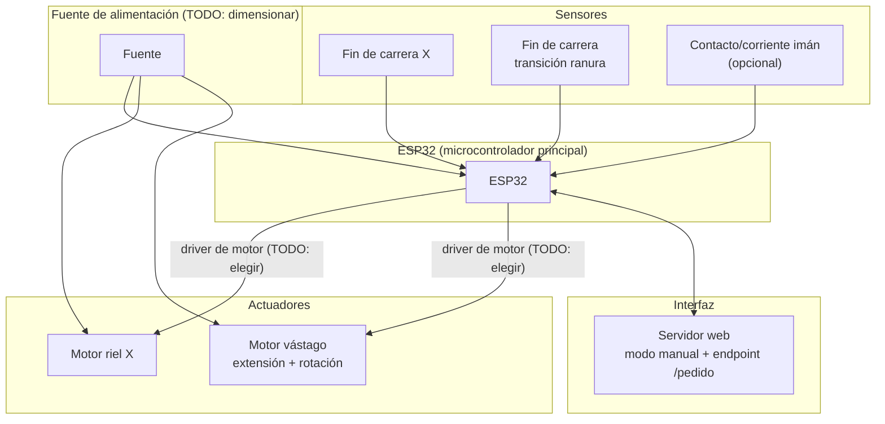

# Diagrama de bloques del sistema

## Pendiente de definir

- Driver/etapa de potencia para cada motor (tipo de motor todavía no elegido: paso a paso, DC con reductora, o servo).
- Dimensionamiento de la fuente de alimentación.
- Si el electroimán se alimenta directo desde la fuente o mediante un driver/transistor controlado por el ESP32.

Ver [pendientes.md](pendientes.md) para la lista completa de decisiones abiertas.
