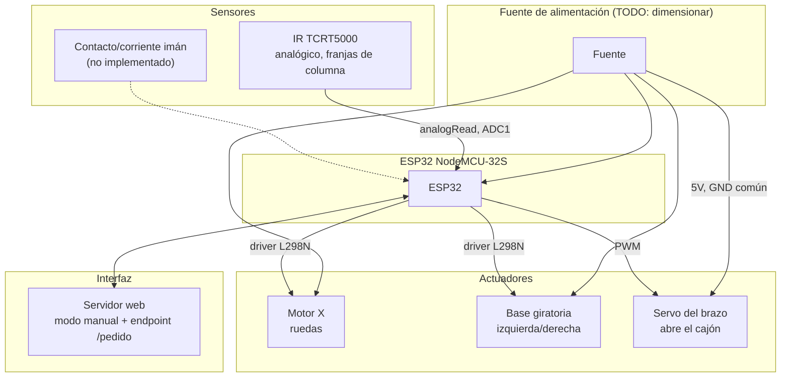

# Diagrama de bloques del sistema

## Pendiente de definir

- Resistencia de 10 kΩ entre GPIO34 y 3V3, sin la cual el sensor lee cerca de 0 siempre.
- Dimensionamiento de la fuente de alimentación.
- Fuente externa de 5V para el servo (con USB se reinicia la placa al moverse).
- Confirmar que `BASE_IN_A/B` (GPIO27/26) y `RUEDAS_IN_A/B` (GPIO32/33) coinciden con el cableado físico actual — ver [pines.md](../firmware/pines.md).

Ver [pendientes.md](pendientes.md) para la lista completa de decisiones abiertas.
