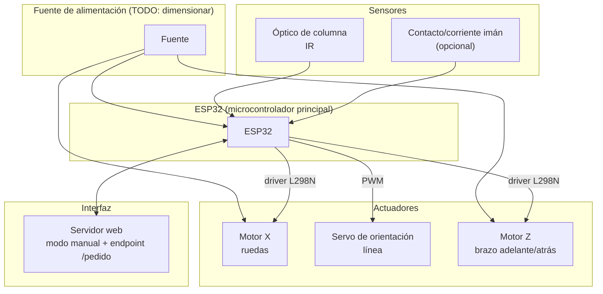

# Diagrama de bloques del sistema

## Pendiente de definir

- Confirmar si las 2 ruedas comparten un solo canal del L298N (control como un único eje X) o van por canales separados.
- Dimensionamiento de la fuente de alimentación.
- Si el electroimán se alimenta directo desde la fuente o mediante un driver/transistor controlado por el ESP32.
- Si el sensor óptico de columna tiene comparador integrado (salida digital) o es un fotodiodo crudo (necesitaría `analogRead()` + umbral) — ver [pendientes.md](pendientes.md).

Ver [pendientes.md](pendientes.md) para la lista completa de decisiones abiertas.
