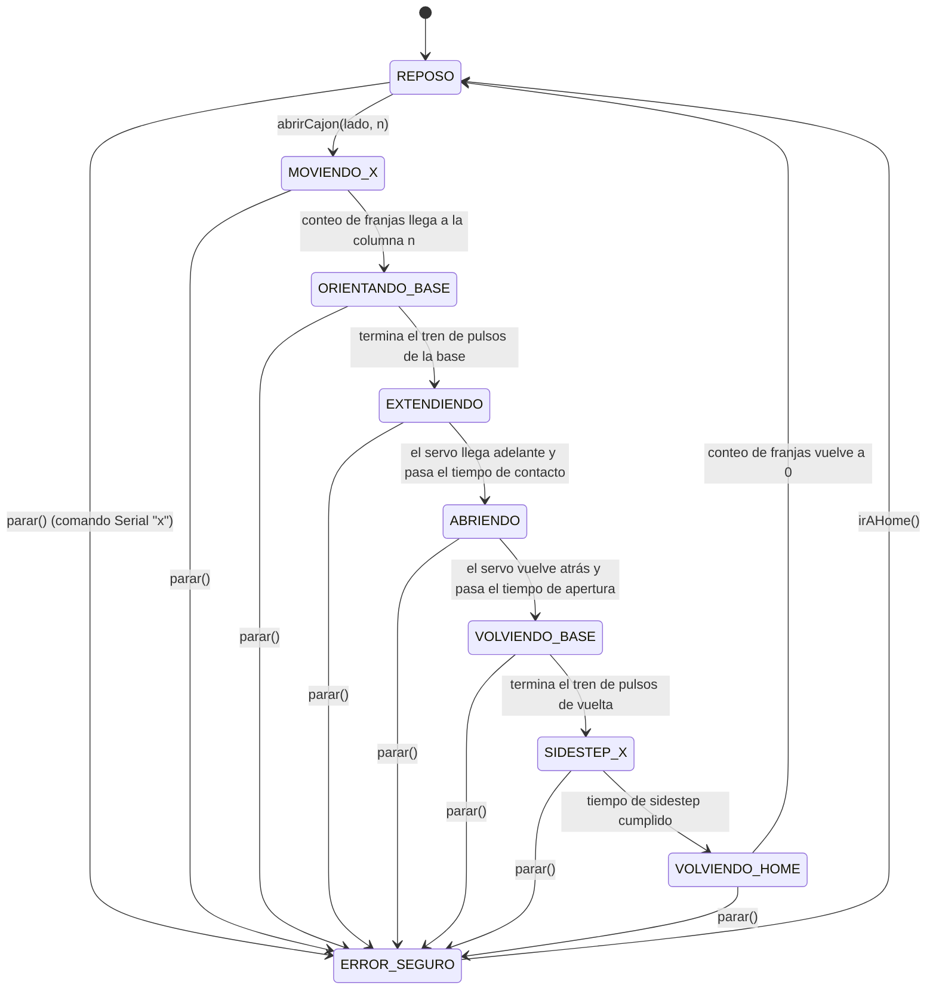

# Diagrama de flujo / máquina de estados de la rutina autónoma

Máquina de estados no bloqueante (basada en `millis()`, no en `delay()`) que corre en el ESP32 (`firmware/include/maquina_estados.h`, `firmware/src/maquina_estados.cpp`).

## Tabla de transiciones

| Estado | Descripción | Condición de salida |
|---|---|---|
| REPOSO | Brazo retraído, base sin girar. Posición segura por defecto. | Llega un pedido (`abrirCajon(lado, n)`) |
| MOVIENDO_X | El robot avanza, contando franjas del sensor de línea. | El conteo llega a la columna n |
| ORIENTANDO_BASE | La base gira hacia el lado pedido (tren de 7 pulsos, calibrado). | Termina el tren de pulsos |
| EXTENDIENDO | El servo avanza el brazo hasta que el imán toca la tuerca del cajón (+ 500ms de espera en contacto). | Servo llegó + tiempo de contacto cumplido |
| ABRIENDO | El servo retrocede despacio: tira del cajón y lo abre (+ 500ms de espera con el cajón abierto). | Servo volvió + tiempo de apertura cumplido |
| VOLVIENDO_BASE | La base gira de vuelta (tren de 6 pulsos). | Termina el tren de pulsos |
| SIDESTEP_X | El robot se desplaza un poco para no empujar el cajón abierto al volver. | Tiempo de sidestep cumplido (800ms) |
| VOLVIENDO_HOME | El robot vuelve en X, contando franjas en sentido inverso. | El conteo vuelve a 0 |
| ERROR_SEGURO | Motores cortados. Accesible desde cualquier estado. | `irAHome()` (hace de reset manual) |

## Nota sobre las fases resueltas por tiempo

Solo `MOVIENDO_X` y `VOLVIENDO_HOME` dependen del sensor de línea (el único sensor confirmado — ver [sensores-actuadores.md](sensores-actuadores.md)). `ORIENTANDO_BASE`, `EXTENDIENDO`, `ABRIENDO`, `VOLVIENDO_BASE` y `SIDESTEP_X` se resuelven por tiempo fijo, con las constantes ya calibradas a mano sobre el hardware real (`src/prueba.cpp`) — no son un placeholder inventado. Si el grupo agrega sensores dedicados más adelante (por ejemplo, un fin de carrera en la base), alcanza con reemplazar esas comparaciones de tiempo por lecturas de sensor, sin tocar el resto de la máquina de estados.

## Modo manual vs. modo autónomo

El modo manual (ver [modo-manual.md](modo-manual.md)) opera fuera de esta máquina de estados: da control directo de ruedas, base y servo desde la interfaz web. El modo autónomo es exclusivamente esta secuencia.
