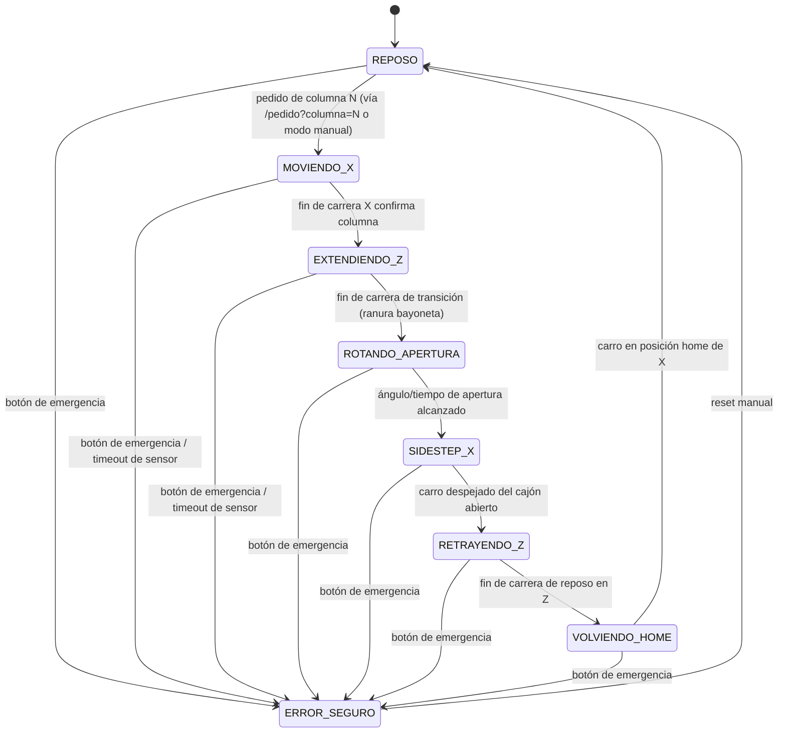

# Diagrama de flujo / máquina de estados de la rutina autónoma

Máquina de estados no bloqueante (basada en `millis()`, no en `delay()`) que corre en el ESP32. La transición a `ERROR_SEGURO` se chequea antes que cualquier otra lógica, desde cualquier estado.

## Tabla de transiciones

| Estado | Descripción | Condición de salida |
|---|---|---|
| REPOSO | Vástago retraído, brazo plegado. Posición segura por defecto (fail-safe por gravedad si se corta la energía). | Llega un pedido de columna N |
| MOVIENDO_X | El carro se traslada por el riel hasta la columna N. | Fin de carrera X confirma posición |
| EXTENDIENDO_Z | El vástago sube en línea recta hasta la altura de la fila de cajones. | Fin de carrera de la transición de la ranura bayoneta |
| ROTANDO_APERTURA | El motor rota el brazo; el imán excéntrico engancha la placa y abre el cajón en un arco corto. | Ángulo/tiempo de apertura alcanzado |
| SIDESTEP_X | El carro se desplaza a una zona sin cajón abierto en el medio, para no volver a empujarlo al retraer. | Carro despejado |
| RETRAYENDO_Z | El vástago se retrae en línea recta. | Fin de carrera de reposo en Z |
| VOLVIENDO_HOME | El carro vuelve por X a la posición de reposo/home. | Carro en home |
| ERROR_SEGURO | Motores cortados (por software y por relé de hardware). Accesible desde cualquier estado. | Reset manual |

## Modo manual vs. modo autónomo

El modo manual (ver [modo-manual.md](modo-manual.md)) opera fuera de esta máquina de estados: da control directo de X y Z/rotación desde la interfaz web. El modo autónomo es exclusivamente esta secuencia.
