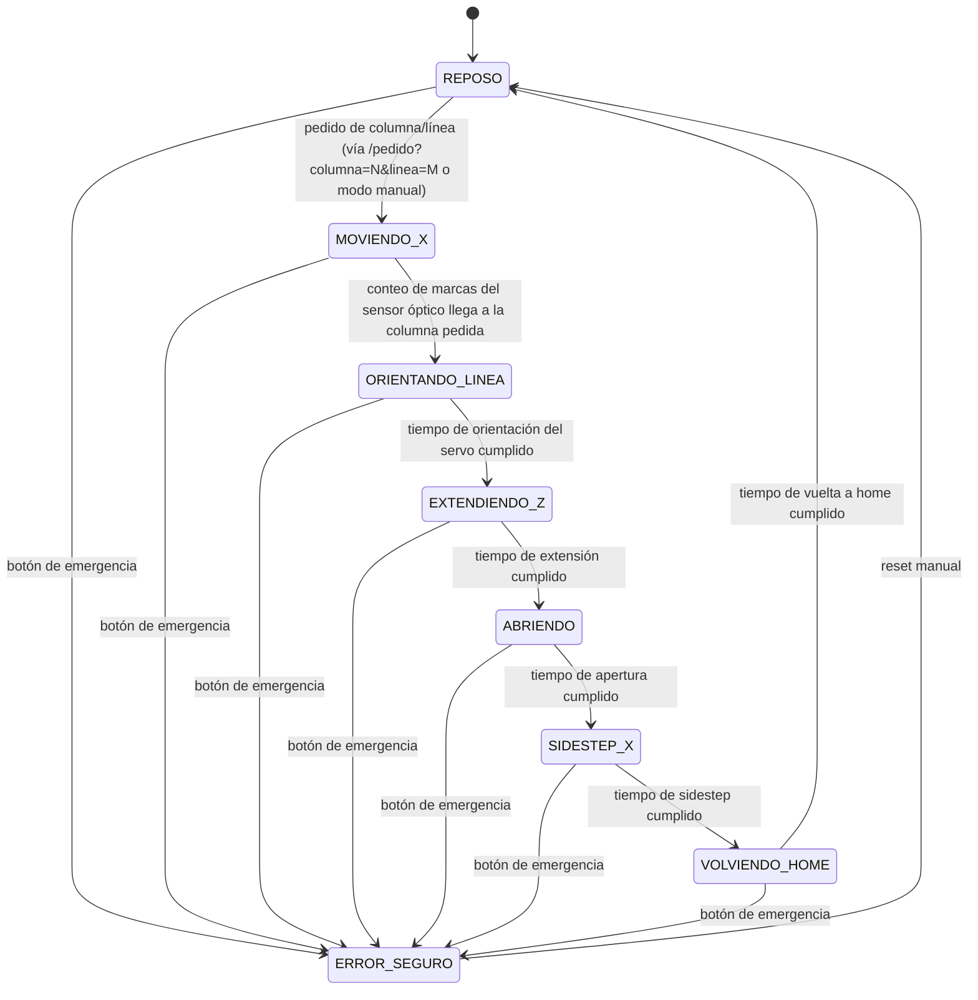

# Diagrama de flujo / máquina de estados de la rutina autónoma

Máquina de estados no bloqueante (basada en `millis()`, no en `delay()`) que corre en el ESP32. La transición a `ERROR_SEGURO` se chequea antes que cualquier otra lógica, desde cualquier estado.

## Tabla de transiciones

| Estado | Descripción | Condición de salida |
|---|---|---|
| REPOSO | Brazo retraído, servo en la línea home. Posición segura por defecto. | Llega un pedido de columna N / línea M |
| MOVIENDO_X | El robot se traslada sobre ruedas hasta la columna N, contando marcas del sensor óptico. | El conteo de marcas llega a N |
| ORIENTANDO_LINEA | El servo gira el brazo hasta la línea M. | Tiempo de orientación cumplido (el servo se autoposiciona) |
| EXTENDIENDO_Z | El motor Z avanza hasta que el imán hace contacto con la placa del cajón. | Tiempo de extensión cumplido |
| ABRIENDO | El motor Z retrocede: tira del cajón (lo abre) y de paso vuelve el brazo a su posición retraída. | Tiempo de apertura cumplido |
| SIDESTEP_X | El robot se desplaza a una zona sin cajón abierto en el medio, para no volver a empujarlo al retornar. | Tiempo de sidestep cumplido |
| VOLVIENDO_HOME | El robot vuelve en X a la posición de reposo/home. | Tiempo de vuelta a home cumplido |
| ERROR_SEGURO | Motores cortados (por software y por relé de hardware). Accesible desde cualquier estado. | Reset manual |

## Nota sobre las fases resueltas por tiempo

Solo `MOVIENDO_X` depende de un sensor (el óptico de columna, único sensor confirmado como mínimo — ver [sensores-actuadores.md](sensores-actuadores.md)). `ORIENTANDO_LINEA`, `EXTENDIENDO_Z`, `ABRIENDO`, `SIDESTEP_X` y `VOLVIENDO_HOME` se resuelven por tiempo fijo, no por sensor dedicado — si el grupo agrega sensores (por ejemplo, un fin de carrera en la extensión de Z) más adelante, alcanza con reemplazar esas comparaciones de tiempo por lecturas de `sensores.*`, sin tocar el resto de la máquina de estados.

## Modo manual vs. modo autónomo

El modo manual (ver [modo-manual.md](modo-manual.md)) opera fuera de esta máquina de estados: da control directo de X, Z y de la línea desde la interfaz web. El modo autónomo es exclusivamente esta secuencia.
